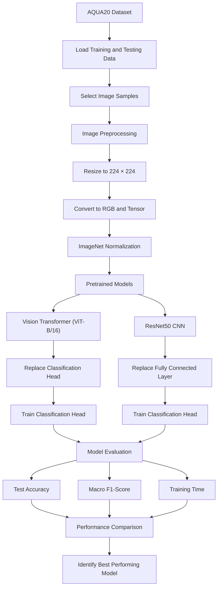
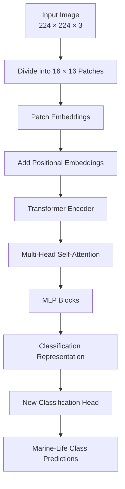
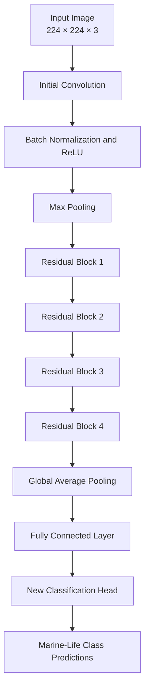

# Ocean Image Classification: Vision Transformer (ViT) vs ResNet50 CNN

A deep learning project that compares two popular image classification architectures — **Vision Transformer (ViT-B/16)** and **ResNet50 CNN** — using transfer learning on the AQUA20 ocean-life image dataset.

Both models use pretrained ImageNet weights and are adapted to classify marine-life categories. Their performance is compared using test accuracy, macro F1-score, and training time.

## Project Overview

The main objective is to understand how Transformer-based and Convolutional Neural Network architectures perform on an ocean-life image classification task.

The project implements:

- **Vision Transformer (ViT-B/16):** Uses image patches and self-attention mechanisms to learn relationships between different regions of an image.
- **ResNet50 CNN:** Uses convolutional layers and residual connections to extract visual features.
- **Transfer Learning:** Uses pretrained ImageNet weights for both architectures.
- **Model Evaluation:** Compares test accuracy, macro F1-score, and training time.
- **Visualization:** Generates a bar chart to compare the classification accuracy of both models.

## Technologies Used

| Technology | Purpose |
|---|---|
| Python | Main programming language |
| PyTorch | Deep learning framework |
| Torchvision | Pretrained ViT and ResNet50 architectures |
| Hugging Face Datasets | Loading the AQUA20 dataset |
| Scikit-learn | Accuracy and F1-score evaluation |
| NumPy | Numerical operations |
| Pandas | Organizing model comparison results |
| Matplotlib | Visualizing model performance |

## Dataset: AQUA20

The project uses the **AQUA20 dataset**, obtained through the Hugging Face Datasets library.

Dataset: [AQUA20 – Hugging Face](https://huggingface.co/datasets/Mrscarce/AQUA20)

The dataset contains ocean-life images belonging to multiple marine-life categories.

The notebook automatically loads the dataset using:

```python
dataset = load_dataset("Mrscarce/AQUA20")
```

The number of categories and their names are extracted directly from the dataset metadata.

**Dataset configuration used in this experiment:**

- Training images: Up to 200.
- Testing images: Up to 100.
- Image dimensions: 224 × 224 pixels.
- Batch size: 8.
- Random seed: 42.

The notebook uses a smaller sample to keep the experiment manageable, particularly on systems without a dedicated GPU.

## Project Architecture

### Overall System Workflow

The following diagram represents the complete workflow implemented in the notebook.



## Model 1: Vision Transformer (ViT-B/16)

The Vision Transformer is a Transformer-based architecture designed for image recognition.

Instead of processing an image entirely through convolutional filters, ViT divides the image into smaller patches and processes them using self-attention.

**Architecture Flow:**



**Implementation details:**

- Architecture: ViT-B/16.
- Pretrained weights: ImageNet.
- Input dimensions: 224 × 224.
- Patch size: 16 × 16.
- Classification head: Replaced with a new linear layer.
- Training approach: Frozen pretrained feature extractor with a trainable classification head.

The pretrained model is loaded using:

```python
vit_weights = models.ViT_B_16_Weights.DEFAULT
vit = models.vit_b_16(weights=vit_weights)
```

The original classification head is replaced to match the number of AQUA20 categories.

## Model 2: ResNet50 CNN

ResNet50 is a 50-layer Convolutional Neural Network that uses residual connections to improve the training of deep neural networks.

Residual connections allow information to bypass certain layers, helping address the vanishing gradient problem.

**Architecture Flow:**



**Implementation details:**

- Architecture: ResNet50.
- Pretrained weights: ImageNet.
- Input dimensions: 224 × 224.
- Residual connections: Used throughout the network.
- Classification layer: Replaced with a new linear layer.
- Training approach: Frozen pretrained feature extractor with a trainable fully connected classification layer.

The pretrained model is loaded using:

```python
cnn_weights = models.ResNet50_Weights.DEFAULT
cnn = models.resnet50(weights=cnn_weights)
```

The original fully connected layer is replaced to predict the AQUA20 categories.

## Transfer Learning Approach

Both architectures use pretrained ImageNet weights.

Instead of training the entire network from scratch, the pretrained feature extraction layers are frozen, and only the newly added classification layers are trained.

This reduces the number of trainable parameters and makes the experiment computationally lighter.

The implementation freezes the model parameters:

```python
for model in [vit, cnn]:
    for parameter in model.parameters():
        parameter.requires_grad = False
```

The new classification layers are then enabled for training:

```python
for parameter in vit.heads.head.parameters():
    parameter.requires_grad = True

for parameter in cnn.fc.parameters():
    parameter.requires_grad = True
```

## Image Preprocessing

Both models use the same preprocessing pipeline to ensure a fair comparison.

1. Resize images to 224 × 224 pixels.
2. Convert images into RGB format.
3. Convert images into PyTorch tensors.
4. Normalize using ImageNet mean and standard deviation.

Normalization parameters:

```python
mean = [0.485, 0.456, 0.406]
std = [0.229, 0.224, 0.225]
```

This preprocessing matches the expected input format of the pretrained torchvision models.

## Model Training

Both models are trained using the same training and testing datasets.

**Training configuration:**

| Parameter | Value |
|---|---|
| Optimizer | Adam |
| Learning Rate | 0.001 |
| Loss Function | CrossEntropyLoss |
| Batch Size | 8 |
| Number of Epochs | 2 |
| Random Seed | 42 |
| Hardware | CUDA if available, otherwise CPU |

The training process follows these steps:

1. Pass image batches through the model.
2. Generate predictions for marine-life categories.
3. Calculate classification loss using CrossEntropyLoss.
4. Perform backpropagation.
5. Update the trainable classification layer using Adam.
6. Repeat for the specified number of epochs.

The training function is reused for both architectures to maintain consistent experimental conditions.

## Model Evaluation

Both models are evaluated on the same testing dataset.

The following metrics are calculated:

| Metric | Description |
|---|---|
| Test Accuracy | Percentage of correctly classified images |
| Macro F1-Score | Average F1-score across all classes, giving each class equal weight |
| Training Time | Time taken to complete the training process |

The results are stored in a Pandas DataFrame for comparison.

## Performance Visualization

A bar chart is generated to compare the test accuracy of ViT and ResNet50.

The visualization includes:

- Vision Transformer test accuracy.
- ResNet50 CNN test accuracy.
- Accuracy comparison between the two architectures.

The notebook also identifies the model with the highest test accuracy.

## Expected Output

After running the notebook, the following outputs are generated:

1. Number of marine-life categories.
2. Number of training and testing images.
3. Image batch dimensions.
4. Training loss for each epoch.
5. Test accuracy for ViT.
6. Macro F1-score for ViT.
7. Training time for ViT.
8. Test accuracy for ResNet50.
9. Macro F1-score for ResNet50.
10. Training time for ResNet50.
11. Final model comparison table.
12. Accuracy comparison bar chart.
13. Best-performing model.

**Note:** Actual accuracy, F1-score, and training time depend on the selected dataset samples and execution environment. Use the values printed by the notebook rather than assuming predetermined results.

## Installation and Execution

### 1. Clone the Repository

```bash
git clone https://github.com/your-username/your-repository-name.git
cd your-repository-name
```

### 2. Install Dependencies

```bash
pip install -q torch torchvision datasets scikit-learn matplotlib pandas
```

### 3. Run the Notebook

Open the notebook using Jupyter Notebook or Google Colab and execute the cells sequentially.

The AQUA20 dataset is loaded automatically through Hugging Face.

The pretrained ViT and ResNet50 weights are downloaded when they are not already available locally.

### 4. Adjust the Dataset Size

The default configuration uses:

```python
TRAIN_SIZE = min(200, len(dataset["train"]))
TEST_SIZE = min(100, len(dataset["test"]))
```

Increase these values to experiment with more images, subject to available memory and processing capacity.

## Project Structure

```text
Ocean-Image-Classification/
│
├── Ocean_Image_Classification_ViT_vs_ResNet50.ipynb
│
└── README.md
```

The dataset and pretrained model weights are downloaded automatically when the notebook is executed. They do not need to be included in the repository.

## Key Learnings

Through this project, the following concepts are explored:

- Image classification using deep learning.
- Transfer learning with pretrained ImageNet models.
- Vision Transformer architecture and self-attention.
- CNN architecture and residual connections.
- Freezing pretrained model parameters.
- Fine-tuning classification heads.
- Image preprocessing and normalization.
- Model evaluation using accuracy and macro F1-score.
- Comparing computational training time across architectures.

## Limitations

- Only a small subset of AQUA20 is used by default.
- Both models are trained for only two epochs.
- The pretrained feature extractors remain frozen.
- The experiment is intended as a lightweight architecture comparison rather than a fully optimized benchmark.
- Training time depends on the available hardware.
- Results may vary depending on the selected samples and execution environment.

## Future Improvements

- Train using the complete AQUA20 dataset.
- Increase the number of training epochs.
- Experiment with partial and full fine-tuning.
- Add confusion matrices and class-wise performance analysis.
- Compare additional architectures such as EfficientNet and VGG16.
- Experiment with data augmentation.
- Evaluate inference time and model size.
- Develop a web application for marine-life image classification.

## Author

**Lavanya Vinodkumar**


---

*This project explores the differences between Transformer-based and CNN-based image classification through a practical transfer learning experiment on ocean-life images.*
